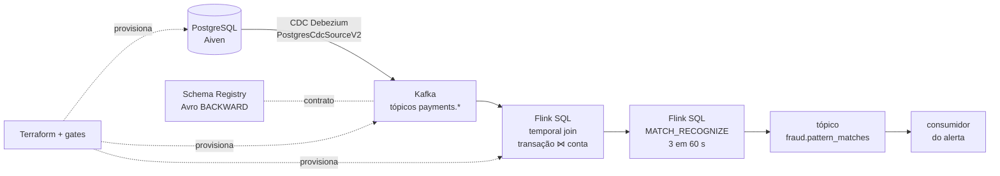

# Pipeline de pagamentos em tempo real

Do banco de dados ao alerta de fraude, tudo no Confluent Cloud:
**PostgreSQL (Aiven) → CDC Debezium → tópicos Kafka em Avro → Flink SQL
(enriquecimento + regra de fraude) → tópico de alertas.**

Uma transação gravada no Postgres vira evento em segundos. O Flink junta cada
transação com o estado da conta naquele instante e marca como suspeitas
**três transações do mesmo cartão em até 60 segundos**. Toda a infraestrutura é
Terraform, cada etapa tem um gate que bloqueia mudanças inesperadas e o
projeto termina com tudo derrubado e conferido.



As evidências abaixo são saídas reais da execução **run-20261111**
(2026-11-12, do zero, em conta vazia). O pipeline foi depois **reproduzido
seguindo apenas a documentação**, num Codespace limpo (**run-20261112**), com
os mesmos resultados. Arquivos sanitizados em
[`evidencias/runs/`](evidencias/runs/).

---

## Camada 1 — Fundação

Environment `desafio-final` e cluster Basic `desafio-basic` (AWS `us-east-1`,
configuráveis por variável). Uma identidade para cada papel, cada uma só com o
que precisa — a conta pessoal só faz login, setup e teardown.

| Identidade | Permissões | Por quê |
|---|---|---|
| `desafio-cdc` | CREATE/WRITE em tópicos `payments*` e `__debezium-heartbeat-*`; DESCRIBE no cluster | O conector cria e escreve os próprios tópicos; não lê nada |
| `desafio-consumer` | READ em `payments.` e `desafio-`; READ no grupo `desafio-` | Quem lê não escreve |
| `desafio-producer` | WRITE em `desafio-` | Quem escreve não lê |
| `payment-fraud-flink-v2` | READ em `payments.public.accounts`; READ/WRITE em transactional IDs `_confluent-flink_`; papel FlinkDeveloper e DeveloperRead nos schemas de `accounts` | Lê as fontes e grava o resultado de forma transacional |
| `desafio-schema-registry` | DeveloperRead/Write nos subjects; DeveloperManage só em `payments.public.transactions-value` | Pode mudar a compatibilidade apenas do contrato testado |
| `desafio-iac-admin` | CloudClusterAdmin só neste cluster | Usada pelo Terraform para gerenciar ACLs, sem acesso ao environment |
| `desafio-metrics` | MetricsViewer (somente leitura) | Lê a Metrics API sem usar a chave administrativa |

Evidência (`confluent kafka acl list`, 14 ACLs — tabela completa em
[identities-and-acls.md](evidencias/runs/run-20261111/foundation/identities-and-acls.md)):

```text
  User:sa-196ypn3 | ALLOW | WRITE            | TOPIC            | desafio-                 | PREFIXED
  User:sa-3n6dx7m | ALLOW | CREATE           | TOPIC            | payments                 | PREFIXED
  User:sa-3n6dx7m | ALLOW | WRITE            | TOPIC            | payments                 | PREFIXED
  User:sa-7pmd25j | ALLOW | READ             | GROUP            | desafio-                 | PREFIXED
  User:sa-7pmd25j | ALLOW | READ             | TOPIC            | payments.                | PREFIXED
  User:sa-r2w6pk7 | ALLOW | WRITE            | TRANSACTIONAL_ID | _confluent-flink_        | PREFIXED
  ...
ONLY_EXPECTED_ACL_CREATES= True    ACL_PLAN_GATE=PASS    ACL_APPLY_GATE=PASS
```

## Camada 2 — Contrato de dados

Os tópicos CDC usam **Avro no Schema Registry** (12 subjects, chave e valor das
6 tabelas). O contrato de `payments.public.transactions-value` recebeu
compatibilidade explícita **BACKWARD**: consumidores com o schema novo leem
dados antigos.

O teste usa o caso que o BACKWARD realmente proíbe: **adicionar campo
obrigatório sem default** (dados antigos não têm o valor). Remover um campo, ao
contrário, é compatível nesse modo — por isso não serve como caso negativo.

```text
SUBJECT= payments.public.transactions-value
ORIGINAL_VERSION= 1
REQUIRED_WITHOUT_DEFAULT_COMPATIBLE= False     ← rejeitado
OPTIONAL_WITH_DEFAULT_COMPATIBLE= True         ← aceito
ORIGINAL_SCHEMA_UNCHANGED= True
NEW_SCHEMA_REGISTERED=False
COMPATIBILITY_GATE= PASS
```

Diff e resultado: [`schemas/`](evidencias/runs/run-20261111/schemas/).

## Camada 3 — Ingestão (CDC)

Conector gerenciado **PostgresCdcSourceV2** (Debezium) lendo o Postgres pela
replicação lógica, com `cdc_user` de menor privilégio (login de replicação e
SELECT; escrita de negócio negada), TLS `verify-full`, `tasks.max=1` e
heartbeat de 60 s. Configuração em
[`infra/terraform/cdc-connector.tf`](infra/terraform/cdc-connector.tf); a
senha vai em `config_sensitive`, nunca em arquivo versionado.

Seed carregado e lido de volta nos tópicos pelo consumidor de leitura:

```text
 customers | accounts | cards | merchants | transactions
-----------+----------+-------+-----------+--------------
       200 |      240 |   320 |        60 |         2000

TOPIC=payments.public.transactions AVAILABLE=2004   (2000 do snapshot + 4 do cenário)
lcc-6k6w7n2 | payments-cdc | RUNNING | source
```

Os três tipos de evento, decodificados do Avro para a mesma transação sintética:

```text
VALIDATED_EVENT=C          op=c: before=null, after com a linha nova
VALIDATED_EVENT=U          op=u: before preenchido (REPLICA IDENTITY FULL) + after
VALIDATED_EVENT=D          op=d: after=null
VALIDATED_EVENT=TOMBSTONE  tombstone logo após o delete
LIFECYCLE_GATE= PASS
```

Detalhes: [connector-topics-and-scenario.md](evidencias/runs/run-20261111/cdc/connector-topics-and-scenario.md).

## Camada 4 — Processamento (Flink SQL)

Dois passos em [`sql/`](sql/):

1. **Temporal join** ([`04_temporal_join.sql`](sql/enrichment/04_temporal_join.sql)):
   cada transação recebe cliente, status e país da conta **como estavam no
   instante da transação** (`FOR SYSTEM_TIME AS OF $rowtime`). Exige chave
   primária nas duas tabelas e `transactions` em modo `append` —
   `lab.py flink-setup` aplica esses três DDLs.
2. **Regra de fraude** ([`01_continuous_matches.sql`](sql/fraud_detection/continuous/01_continuous_matches.sql)):
   `MATCH_RECOGNIZE` com `PARTITION BY card_id`, `PATTERN (T{3})`,
   `WITHIN INTERVAL '60' SECOND`, valor `> 0`, `AFTER MATCH SKIP PAST LAST ROW`.
   O resultado contínuo vai para o tópico **`fraud.pattern_matches`** com o
   cartão e os três `transaction_id`.

Enriquecimento sem perda nem duplicação:

```text
SOURCE_TRANSACTION_COUNT= 2004    RESULT_ROWS= 2004    DISTINCT_TRANSACTIONS= 2002
CUSTOMER_IDS_PRESENT= 2004        COUNTRY_CODES_PRESENT= 2004
NO_LOSS= True    NO_DUPLICATION= True    STAGE9_DATA_GATE= PASS
```

O alerta: o cenário grava 1 transação legítima num cartão e 3 transações em
outro cartão em menos de 60 s. A verificação procura, no tópico de alertas, as
correspondências que contêm esses IDs:

```text
STATEMENT_PHASE=RUNNING                     (etapa11-fraud-pattern-matches)
FRAUD_SEQUENCE_MATCHED=True                 ← as 3 transações, na ordem, num único alerta
FRAUD_MATCHES_FOR_SCENARIO=1
LEGITIMATE_IN_ANY_MATCH=False               ← o cartão legítimo não gerou alerta
SCENARIO_ALERT_GATE=PASS
```

[`fraud-scenario-alert.json`](evidencias/runs/run-20261111/flink/fraud-scenario-alert.json)
guarda só booleanos (os IDs não são persistidos).

## Camada 5 — Operação: as quatro respostas

| Pilar | Resposta (medida) |
|---|---|
| ① **Observabilidade** | Metrics API, `received_bytes` do cluster, 43 pontos de 1 min (01:57–02:39 UTC): **pico de 180.626 bytes/min** no snapshot, 233.839 bytes no total ([metrics-api-received-bytes.json](evidencias/runs/run-20261111/observability/metrics-api-received-bytes.json)). Lag por grupo: **sem série** — ver limitação abaixo. |
| ② **Segurança** | Tabela da Camada 1 (identidade → ACL → por quê). No Postgres, `cdc_user` com `CDC_BUSINESS_WRITE_DENIED=True`. Nenhuma credencial versionada: `.env` e State ficam fora do Git, os scripts nunca imprimem segredos e as falhas do provider são classificadas sem gravar o texto original. |
| ③ **Custos** | **US$ 1,32 por execução completa** (fatura da Confluent, tabela abaixo), coberto pelo crédito de avaliação. O conector é **77 %** do custo. Alavancas: (1) o conector só existe durante a janela de prova, com `tasks.max=1` — cobrado por hora de task, então uma janela que caiba numa única hora cheia corta esse item pela metade; (2) os statements Flink são apagados no fim da janela — o pool só cobra CFU com statement rodando, e `max_cfu=10` limita o teto. |
| ④ **Confiabilidade** | Tabela abaixo. Elo fraco: **consumidor → efeito**. |

| Trecho | Garantia | Como foi verificado | Risco |
|---|---|---|---|
| Postgres → Debezium | WAL + slot lógico `payments_cdc_slot`; `REPLICA IDENTITY FULL` | `before` presente no `op=u` | O slot retém WAL se o conector parar com o banco no ar |
| Debezium → Kafka | Pelo menos uma vez | 2004 = 2000 + 4 eventos do cenário | Reinício do conector pode reenviar eventos |
| Kafka → Flink | Offsets no estado do Flink | Join com 2004 linhas, sem perda nem duplicação | Sem eventos novos o watermark para e o alerta atrasa |
| Flink → `fraud.pattern_matches` | Escrita transacional | Um único alerta para o cenário | — |
| Alertas → consumidor | Pelo menos uma vez | Fora do escopo do desafio | **O efeito (bloquear cartão, notificar) pode se repetir; a idempotência por `(card_id, first_transaction_id, last_transaction_id)` é responsabilidade do código do consumidor** |

### Custo total e teardown

**Custo declarado** — fatura de novembro/2026 exportada do console da
Confluent (Billing → Invoices → CSV), uma linha por recurso:

| Item | Preço | run-20261111 | run-20261112 (guiada) |
|---|---|---|---|
| Conector CDC (`ConnectNumTasks`) | US$ 0,50 / task-hora | 2 task-h → US$ 1,000 | 2 task-h → US$ 1,000 |
| Flink (`FlinkNumCFUs`) | US$ 0,21 / CFU-hora | 0,87 CFU-h → US$ 0,182 | 0,73 CFU-h → US$ 0,154 |
| Kafka Basic (`KafkaNumCKUs`) | US$ 0,135 / CKU-hora | 1 CKU-h → US$ 0,135 | 1 CKU-h → US$ 0,135 |
| **Total bruto** | | **US$ 1,317** | **US$ 1,289** |

Total das duas execuções: **US$ 2,61**, integralmente coberto pelo crédito
`FREETRIAL400` — **valor pago: US$ 0,00**. O Postgres usa o plano gratuito da
Aiven. Teto definido antes da execução: US$ 5 e 2 h de janela. Evidência:
[billing-final.json](evidencias/runs/run-20261111/operations/billing-final.json).
O conector ficou ativo por cerca de uma hora em cada execução e foi cobrado
por 2 task-horas — consistente com cobrança por hora iniciada, já que as duas
janelas cruzaram a virada de hora (01:5x→02:55 e 17:59→18:1x UTC).

- **Teardown executado ao final**, com listas vazias:

```text
$ confluent connect cluster list ...        None found.
$ confluent flink statement list ...        None found.
$ terraform -chdir=infra/terraform state list
(vazio)
$ confluent environment list                (só o environment "default" da conta)
```

O primeiro teardown falhou no meio por um defeito de ordem de destruição, que
foi corrigido e registrado:
[closure-and-teardown.md](evidencias/runs/run-20261111/teardown/closure-and-teardown.md).

---

## Por que cada peça

- **CDC em vez de batch:** a regra é de segundos; um batch periódico chegaria
  depois do terceiro pagamento. O CDC lê o log do banco, sem consultas sobre as
  tabelas e sem perder updates e deletes.
- **Aiven PostgreSQL:** plano gratuito com replicação lógica e TLS — o exemplo
  da DIO usa Neon; a troca não muda o conector.
- **Avro + Schema Registry + BACKWARD:** o formato fica registrado fora do
  código, e uma mudança que quebraria consumidores é recusada antes de chegar
  ao tópico.
- **Temporal join:** a fraude é avaliada com a conta como estava naquele
  momento, não como está hoje.
- **`MATCH_RECOGNIZE` e 60 s:** expressa "3 eventos seguidos do mesmo cartão
  numa janela" de forma declarativa; 60 s é a janela pedida pelo desafio e
  curta o bastante para separar uso normal de rajada.
- **Terraform com gates:** cada etapa só aplica o que o seu gate espera (ex.:
  exatamente 11 ACLs, só o conector); qualquer destroy/update inesperado bloqueia.

## Como subir do zero e derrubar tudo

O passo a passo completo, com critério de PASS e recuperação em cada etapa,
está em **[docs/runbook.md](docs/runbook.md)**. Resumo:

1. **Ambiente** — Codespaces é opcional: o devcontainer já traz Python 3.12,
   Terraform e Confluent CLI. Em máquina própria, use Linux/macOS (shell) ou
   Windows (PowerShell) com Python 3.12+, Terraform 1.16+ e Confluent CLI 4.81+
   ([local-bootstrap.md](docs/local-bootstrap.md)).
2. **Credenciais** — copie `.env.example` para `.env` e preencha só
   `AIVEN_TOKEN`, `CONFLUENT_CLOUD_API_KEY`, `CONFLUENT_CLOUD_API_SECRET` e
   `TF_VAR_aiven_project`. O resto é gerado pelos scripts.
3. **Subir** — `lab.py setup` → fundação e pipeline (`lab.py plan/apply`,
   `plan-pipeline/apply-pipeline`) → Postgres → ACLs → janela faturável
   (conector, contrato, Flink, cenários, métricas).
4. **Derrubar** — `scripts/teardown_cdc_connector.py --execute` no fim da
   janela e `python lab.py teardown --confirm-destroy`, que apaga statements
   Flink e todos os recursos; depois as listas vazias acima.

Requisitos de quem reproduz: contas próprias na Aiven (projeto + token) e na
Confluent Cloud (Cloud API key com permissão de organização) e créditos para
~1 h de conector e Flink.

## Estado da reprodutibilidade

| Gate | Situação |
|---|---|
| Execução de ponta a ponta do zero (run-20261111) | **Feita.** Revelou 11 defeitos, todos corrigidos e cobertos por testes. |
| Reprodução seguindo só esta documentação, em Codespace limpo (run-20261112) | **Feita**, pelo mesmo operador e sem orientação fora do roteiro. Cada ponto em que o texto não bastou virou um desvio documentado e corrigido (D1–D12 em [reproduction-readiness-backlog.md](docs/audits/reproduction-readiness-backlog.md)). Resultados iguais aos da primeira: ciclo CDC c/u/d/tombstone, BACKWARD, join sem perda (2002 linhas), alerta do cenário, `received_bytes` (pico de 538.907 B/min), teardown completo. |
| Reprodução por outra pessoa/conta | Não executada. |

Depois da execução guiada entraram apenas melhorias de operação — comando de
custo do J7, 3 tentativas nas confirmações e `python lab.py status` para
retomar após uma queda —, cobertas por testes, mas ainda não exercitadas numa
nova janela na nuvem.

Limitações conhecidas: lag do consumidor sem série (o cluster Basic não tem
`lag summarize`, e a auditoria lê sem commit de offsets); `kafka cluster list`
não informa a data de criação; scripts fora do roteiro são diagnósticos
históricos. Detalhes em [docs/runbook.md](docs/runbook.md#limitações-conhecidas).

## Estrutura

| Pasta | Conteúdo |
|---|---|
| [`infra/terraform/`](infra/terraform/) | Toda a infraestrutura e as permissões |
| [`database/`](database/) | Schema, seed e grants do Postgres |
| [`sql/`](sql/) | Statements Flink (enriquecimento, regra, inspeção) |
| [`scripts/`](scripts/), [`lab.py`](lab.py) | Etapas com gates, coleta de evidência e teardown |
| [`src/consumer/`](src/consumer/) | Consumidor de leitura e verificação Avro do CDC |
| [`evidencias/`](evidencias/) | Saídas sanitizadas por execução |
| [`docs/`](docs/README.md) | Roteiro, arquitetura, decisões e validação |
| [`tests/`](tests/) | Testes locais (`python lab.py test`) |
