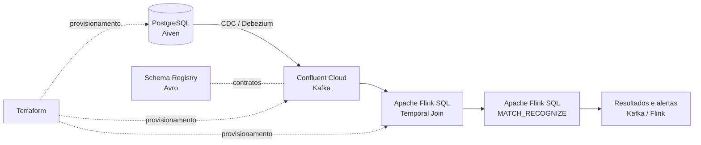

# Real-Time Payment Fraud Pipeline

Pipeline de processamento de pagamentos em tempo real, com captura de alterações no PostgreSQL, streaming no Apache Kafka e detecção de padrões suspeitos por meio de Apache Flink SQL.

O projeto demonstra como integrar serviços gerenciados de banco de dados, mensageria e processamento de eventos utilizando **infraestrutura como código**, contratos de dados e consultas SQL contínuas.

A [documentação técnica](docs/README.md) reúne requisitos, decisões arquiteturais, contratos e evidências, distinguindo implementação de validação em nuvem.

## Visão geral

Uma transação registrada no PostgreSQL precisa se tornar um evento disponível para análise com o menor atraso possível. Neste projeto, essa propagação ocorre por **Change Data Capture (CDC)**: alterações no banco são capturadas pelo Debezium e publicadas em tópicos Kafka. O Flink consome os eventos, realiza enriquecimento temporal e identifica sequências de pagamentos potencialmente suspeitas.

A regra analítica central identifica **três transações de um mesmo cartão em uma janela de 60 segundos**, usando `MATCH_RECOGNIZE` do Flink SQL. A detecção é um exemplo didático de processamento de eventos complexos (*Complex Event Processing — CEP*), e não um motor de prevenção de fraude pronto para produção.

### Arquitetura



| Componente | Responsabilidade |
| --- | --- |
| **Aiven PostgreSQL** | Armazenamento transacional e origem dos registros de pagamentos. |
| **Debezium CDC (Confluent Cloud)** | Captura de alterações do PostgreSQL e publicação dos eventos no Kafka. |
| **Apache Kafka** | Transporte de eventos entre a origem e o processamento. |
| **Schema Registry / Avro** | Gerenciamento dos contratos e da compatibilidade de schemas. |
| **Apache Flink SQL** | Enriquecimento temporal, análise de eventos e detecção do padrão de fraude. |
| **Terraform** | Declaração e gerenciamento da infraestrutura e das permissões. |
| **Ambiente de execução** | Terminal local ou remoto com Python, Terraform e Confluent CLI; Codespaces é opcional. |

## Pré-requisitos

É necessário possuir:

- Um ambiente local ou remoto compatível com as ferramentas do projeto (Windows, Linux ou macOS).
- Git, Python e Terraform, conforme os requisitos de versão definidos neste repositório.
- Confluent CLI e acesso às contas Aiven e Confluent Cloud utilizadas pela arquitetura.
- Uma conta **Aiven** com permissão para administrar um serviço PostgreSQL compatível com replicação lógica.
- Uma conta **Confluent Cloud** com permissões para Kafka, Schema Registry, Connect e Flink, conforme os recursos provisionados.
- Credenciais de API válidas para os provedores, configuradas como segredos do ambiente.
- Créditos ou orçamento para executar serviços gerenciados. **A infraestrutura não é necessariamente gratuita.**

O projeto exige **Python 3.12+**, **Terraform 1.16+** e **Confluent CLI 4.81+** (mínimos verificados em `lab.py`). Instale as dependências Python de `requirements.txt`. O GitHub Codespaces é opcional; o `.devcontainer/` oferece uma configuração de conveniência, com versões de referência das ferramentas; consulte `infra/terraform/versions.tf` para os providers.

**Atenção à portabilidade:** o projeto é projetado para execução em terminais compatíveis, mas os testes locais não demonstram uma implantação de ponta a ponta em todos os sistemas operacionais. Consulte [Implantação e portabilidade](docs/deployment.md).

> **Custos:** o conector CDC gerenciado pode gerar cobrança enquanto estiver provisionado, mesmo sem processar novos registros. Planeje uma janela curta de execução e o desligamento dos recursos que não precisam permanecer ativos.

## 1. Preparar o ambiente de execução

**Bootstrap portátil (Windows, Linux e macOS):** após clonar o repositório, consulte as instruções específicas para seu sistema:

```text
python -m scripts.bootstrap_local instructions
```

Use o Python 3.12+ instalado para executar esse comando (no Windows pode ser `py -3.12`, conforme disponibilidade). O assistente de diagnóstico **não instala** softwares nem acessa a nuvem; fornece links oficiais e instruções de `PATH`. Depois de instalar as ferramentas, execute `python -m scripts.check_environment`. Para criar um `.env` local a partir do modelo **sem substituir arquivo existente**, execute:

```text
python -m scripts.bootstrap_local init-env
```

**Instalação simplificada da Confluent CLI no Windows AMD64 (PowerShell, após o clone):**

```powershell
powershell -NoProfile -ExecutionPolicy Bypass -File .\scripts\install_confluent_cli.ps1

if ($LASTEXITCODE -ne 0) {
    throw "Falha na instalação da Confluent CLI."
}

# Disponibiliza a CLI imediatamente no terminal atual.
$cliPath = Join-Path $env:LOCALAPPDATA "Programs\ConfluentCLI"

if (-not (Test-Path (Join-Path $cliPath "confluent.exe"))) {
    throw "Executável da Confluent CLI não encontrado."
}

if ($cliPath -notin ($env:Path -split ';')) {
    $env:Path = "$cliPath;$env:Path"
}

confluent version
python -m scripts.check_environment
```

O instalador versionado baixa **somente** o ZIP oficial da Confluent, valida o SHA-256 publicado nos metadados do release, instala para o usuário atual e configura o `PATH`, sem privilégios administrativos. Interrompe a instalação caso não consiga verificar o hash. Leia o script antes de executar; não utilize `curl | iex`. A instalação da CLI **não exige conta nem API Keys**. Para Linux/macOS, siga os comandos de gerenciadores de pacotes oficiais no [guia da Confluent](https://docs.confluent.io/confluent-cli/current/install.html) e valide com `confluent version`. Se a CLI já estiver instalada e cumprir a versão mínima, ignore esta instalação.

**Ferramenta ausente ou fora do `PATH`?** Execute `python -m scripts.bootstrap_local repair-tools` com o Python 3.12+ disponível; esse diagnóstico orienta a instalação e a configuração do `PATH`, sem alterar o computador. Consulte [recuperação multiplataforma](docs/local-bootstrap.md#recuperação-guiada-quando-uma-cli-está-ausente-ou-abaixo-do-mínimo).

Antes de provisionar, valide os nomes de configuração presentes com `python -m scripts.check_configuration foundation`; depois da Foundation use `python -m scripts.check_configuration pipeline`. Diagnósticos adicionais: `postgres` e `cdc`. Nenhum desses comandos acessa a nuvem ou imprime credenciais.

A criação não preenche credenciais, e o arquivo `.env` deve permanecer fora do controle de versão. Consulte [o guia de bootstrap multiplataforma](docs/local-bootstrap.md).


Depois de instalar Git, Python 3.12+, Terraform 1.16+ e Confluent CLI 4.81+ pelas instruções do [guia multiplataforma](docs/local-bootstrap.md), prepare o ambiente virtual e instale as dependências:

**Windows (PowerShell):**

```powershell
py -3.12 -m venv .venv
.\.venv\Scripts\python.exe -m pip install -r requirements.txt
.\.venv\Scripts\python.exe lab.py setup
.\.venv\Scripts\python.exe lab.py check-cli
.\.venv\Scripts\python.exe lab.py test
```

**Linux/macOS (shell):**

```bash
python3 -m venv .venv
.venv/bin/python -m pip install -r requirements.txt
.venv/bin/python lab.py setup
.venv/bin/python lab.py check-cli
.venv/bin/python lab.py test
```

Esses comandos validam ferramentas e testes locais, **sem provisionar os serviços externos**. Os executáveis `terraform` e `confluent` precisam estar disponíveis no `PATH`. Se o comando `py -3.12` não existir no Windows, utilize o executável Python 3.12+ instalado.

## 2. Configurar credenciais e parâmetros

Forneça credenciais por variáveis de ambiente do sistema ou por `.env` **local e não versionado**, a partir de `.env.example`. Em ambientes remotos, utilize um mecanismo de gestão de segredos compatível (por exemplo, variáveis protegidas do provedor); Codespaces Secrets são apenas uma opção.

| Variável | Finalidade |
| --- | --- |
| `AIVEN_TOKEN` | API da Aiven. |
| `CONFLUENT_CLOUD_API_KEY` / `CONFLUENT_CLOUD_API_SECRET` | API da Confluent Cloud. |
| `TF_VAR_aiven_project` | Projeto Aiven **preexistente**, onde será criado o PostgreSQL. |
| `TF_VAR_aiven_pg_service_name` | **Opcional.** Terraform usa `payments-postgres` por padrão; configure outro nome somente se já existir um serviço com esse nome no projeto. |
| `TF_VAR_foundation_*` | Parâmetros e chaves gerados/obtidos após a criação da Foundation, quando necessários. |

**Ordem mínima de autenticação (após instalar a CLI):** crie o `.env` local e obtenha as credenciais administrativas **antes** de `lab.py plan`/`apply`. A instalação de ferramentas não necessita dessas chaves.

1. **Aiven (console):** crie conta e projeto, gere um token em **User information > Tokens** e preencha `AIVEN_TOKEN` e `TF_VAR_aiven_project` no `.env`. Não instale outra CLI e não crie PostgreSQL manualmente.
2. **Confluent Cloud (CLI):** crie a conta/organização, execute `confluent login` e confira a organização/contexto selecionados. Em seguida, **quando autorizado a criar uma credencial**:

   ```text
   confluent api-key create --resource cloud --description "fraud-pipeline-reproduction"
   ```

   Copie a chave e o segredo exibidos **uma única vez**, diretamente para `CONFLUENT_CLOUD_API_KEY` e `CONFLUENT_CLOUD_API_SECRET` no `.env` local; **não compartilhe nem redirecione a saída para logs**. A criação requer permissão na organização e a chave deve possuir somente os privilégios necessários ao provisionamento. `confluent login` sozinho **não substitui** essa chave para Terraform. O comando cria credenciais, não serviços de infraestrutura.
3. **Depois da Foundation:** `python -m scripts.export_foundation_env` obtém os outputs de recursos criados (Kafka/Schema Registry e parâmetros de conexão quando disponíveis). **Não crie antecipadamente** chaves de clusters ainda inexistentes nem copie IDs de outra instalação.

Documentação: [criar API Key da Confluent](https://docs.confluent.io/confluent-cli/current/command-reference/api-key/confluent_api-key_create.html) e [criar token Aiven](https://aiven.io/docs/platform/howto/create_authentication_token).

**Antes da Foundation:** crie suas próprias contas/projeto Aiven e organização Confluent Cloud com as permissões exigidas; gere as chaves administrativas conforme [o guia de implantação](docs/deployment.md) e faça `confluent login` em um terminal privado. O login da CLI não substitui as API Keys usadas pelo Terraform. Confira o contexto ativo antes de consultar ou alterar recursos. Não copie identificadores ou credenciais de execuções anteriores.

**Na Aiven, crie apenas a conta, um projeto e um token de API. Não crie o PostgreSQL manualmente.** O projeto deve estar na organização à qual o token tem acesso, e o usuário do token deve ter permissão para criar serviços. A interface pode apresentar diversos tipos de serviço; não selecione nenhum deles manualmente para a reprodução. O recurso `aiven_pg` fixa o tipo PostgreSQL no Terraform. Informe `AIVEN_TOKEN` e `TF_VAR_aiven_project` no `.env` local; `aiven_project` é o nome técnico do projeto (não o ID da organização). O Terraform escolhe o tipo PostgreSQL e o plano `free-1-1gb` e usa o nome padrão `payments-postgres` para o serviço. Esse nome deve estar livre no projeto; se não estiver, defina `TF_VAR_aiven_pg_service_name` para outro nome disponível. A aplicação depende de aprovação, disponibilidade do plano e permissões na conta.

**O projeto Aiven deve existir antes da implantação; o Terraform cria o serviço PostgreSQL, não a conta/projeto Aiven.** As credenciais Kafka/Schema Registry geradas pelo Terraform podem ser exportadas para o `.env` local usando:

```bash
python scripts/export_foundation_env.py
```

Execute a exportação somente após o provisionamento correspondente. Os valores já definidos no ambiente têm precedência sobre o `.env` para os scripts que usam o carregador do projeto. Não publique `.env`, arquivos de State ou planos Terraform: eles podem conter segredos. Não cole saídas brutas de ferramentas contendo credenciais em logs ou issues.

## 3. Provisionar a infraestrutura

Os arquivos de infraestrutura estão em `infra/terraform/`. Eles descrevem os serviços de origem, recursos da Confluent Cloud, identidades, permissões, contratos de dados e componentes necessários ao processamento.

A implantação ocorre em **duas fases**, e os comandos abaixo devem ser executados na ordem indicada. Use `python` com o ambiente virtual ativado ou o executável do `.venv` (`.\.venv\Scripts\python.exe` no PowerShell; `.venv/bin/python` no Linux/macOS). **Os comandos `apply` modificam recursos remotos e podem gerar custos.**

**Fase 1 — Foundation (infraestrutura inicial):**

```text
python -m scripts.check_configuration foundation
python lab.py plan
python lab.py review-plan
python lab.py apply --confirm-foundation
```

O `plan` deve produzir o plano restrito aos recursos Foundation, e `review-plan` deve aprovar somente alterações autorizadas. `apply` exige confirmação explícita. Se o plano for rejeitado, **não** contorne a allowlist: investigue a divergência. Antes de aplicar, confirme permissões, State e orçamento; não execute aplicações concorrentes sobre a mesma infraestrutura.

**Transição entre as fases — exportar outputs e validar configuração:**

```text
python -m scripts.export_foundation_env
python -m scripts.check_configuration pipeline
```

O exportador lê os outputs da Foundation e preenche variáveis `TF_VAR_foundation_*` no `.env` local; não transcreva esses valores manualmente nem publique o arquivo. Os outputs só existirão após a aplicação da primeira fase.

**Fase 2 — pipeline completo (revisão antes de criar):**

```text
python lab.py plan-pipeline
python lab.py review-plan --pipeline
python lab.py apply-pipeline --confirm-pipeline
```

A inclusão do conector CDC pode gerar cobrança e requer autorização adicional `--allow-cdc`, **somente** na janela em que se pretende ativá-lo. Para efetivar uma aplicação que inclua o CDC, após revisão do plano, use `python lab.py apply-pipeline --confirm-pipeline --allow-cdc`; sem essa opção o gate deve bloquear a criação do conector. Consulte [implantação](docs/deployment.md) antes dessa opção. `plan-pipeline` é distinto de `plan` e não substitui a revisão de ambos os planos.

A implantação depende de credenciais válidas e de configurações específicas da conta. Identificadores de ambiente, cluster e Compute Pool devem ser obtidos dos recursos provisionados, e não copiados de execuções anteriores.

Após a aplicação, confirme o inventário:

```bash
confluent environment list
confluent kafka cluster list
confluent flink compute-pool list
confluent iam service-account list
confluent kafka acl list
```

Esses comandos consultam a conta ativa na CLI. Verifique se o contexto selecionado corresponde ao ambiente implantado.

## 4. Preparar os dados e iniciar a captura CDC

O fluxo de ingestão começa no PostgreSQL. A origem deve conter as tabelas transacionais exigidas pelo projeto e estar configurada para permitir replicação lógica.

O conector gerenciado Debezium lê as alterações dessas tabelas e as envia aos tópicos Kafka. **Sua criação é uma operação remota potencialmente faturável.** Utilize o procedimento de ativação e desativação definido no Terraform e nos scripts do repositório; não crie um conector manual paralelo.

**Preparação PostgreSQL e CDC (somente após obter o endpoint e credenciais da infraestrutura):** configure `PGHOST`, `PGPORT`, `PGDATABASE`, `PGUSER`, `PGPASSWORD`, `PG_CA`, `CDC_PGUSER`, `CDC_PGPASSWORD` e `TF_VAR_cdc_connector_password` conforme `.env.example` e [implantação](docs/deployment.md). Recupere o certificado CA para `.local/aiven-ca.pem` utilizando `python scripts/fetch_aiven_ca.py` com `TF_VAR_aiven_project` configurado; confirme o caminho da CA no ambiente local, que é diferente entre Windows e Linux. Não mostre valores de segredos em saídas ou commits.

```text
python -m scripts.check_configuration postgres
python scripts/bootstrap_postgres.py check
python -m scripts.check_configuration cdc
python scripts/preflight_postgres_cdc.py
```

A inicialização de tabelas (`bootstrap_postgres.py apply`) e a configuração do usuário de replicação (`python scripts/configure_cdc_user.py`) **alteram o PostgreSQL**: execute-as somente após revisar as verificações e confirmar que está conectado ao serviço correto. Valide `wal_level`, publication, slot e permissões antes de ativar o conector. A senha do conector CDC deve ser configurada com segurança; não deve ser codificada em Terraform ou no README. A presença do conector em `RUNNING` não dispensa a prova de eventos no Kafka.

Para verificar os conectores disponíveis:

```bash
confluent connect cluster list
```

Para consultar os tópicos do cluster selecionado:

```bash
confluent kafka topic list
```

**Validação esperada:** eventos originados por alterações no PostgreSQL chegam ao Kafka com os schemas previstos. A existência do conector ou dos tópicos, por si só, não comprova que o CDC esteja entregando eventos.

## 5. Executar o processamento no Flink

Os arquivos SQL do projeto ficam organizados no diretório `sql/`. Os componentes principais são:

1. **Enriquecimento temporal:** combinação de transações com o estado correspondente das contas no instante do evento (*temporal join*).
2. **Detecção do padrão:** aplicação de `MATCH_RECOGNIZE`, particionando os eventos por cartão e identificando três transações em até 60 segundos.
3. **Consulta contínua:** materialização dos resultados da detecção para inspeção e consumo posterior.

Consulte os arquivos:

```text
sql/fraud_detection/pattern/01_match_recognize.sql
sql/fraud_detection/continuous/01_continuous_matches.sql
sql/fraud_detection/continuous/02_inspect_matches.sql
```

**Sequência operacional Flink (após confirmar eventos CDC/Avro):**

```text
python lab.py flink-setup
python lab.py flink-setup --apply
python -m scripts.fraud_stream plan
python -m scripts.fraud_stream start --confirm-start
```

`flink-setup --apply` e `fraud_stream start` modificam o ambiente remoto e exigem as confirmações previstas nos scripts. Confirme os statements em `RUNNING` na Confluent Cloud. Inspecione os resultados pelo SQL `sql/fraud_detection/continuous/02_inspect_matches.sql` e correlacione os IDs de `fraud.pattern_matches` com os cenários sintéticos.

O processamento contínuo deve ser iniciado com o executor Flink do repositório, após a disponibilização da origem Kafka e a validação das permissões da identidade de execução. Utilize a ajuda dos scripts para conferir os argumentos aceitos pela versão instalada, em vez de inserir IDs ou nomes fixos nos comandos.

O resultado esperado é a identificação de uma sequência de três transações de um mesmo cartão dentro do intervalo definido, mantendo identificadores que permitam rastrear os registros participantes.

## 6. Simular transações e verificar a detecção

O projeto contém um gerador de cenários em:

```text
scripts/fraud_scenarios.py
```

Primeiro, confira o plano local:

```text
python -m scripts.fraud_scenarios plan
```

Após revisar o plano e autorizar os testes que inserem transações no PostgreSQL, execute:

```text
python -m scripts.fraud_scenarios execute --confirm-execute
```

Durante a janela de integração, com o conector CDC e o processamento contínuo ativos, execute o cenário autorizado usando a interface `execute` do mesmo script. Ele foi desenvolvido para produzir um caso de controle e uma sequência de transações sintéticas que satisfaça o padrão de detecção.

Para inspecionar as correspondências, consulte o executor e o SQL de leitura em:

```text
scripts/fraud_stream.py
sql/fraud_detection/continuous/02_inspect_matches.sql
```

**Consultas operacionais do executor Flink:** depois da criação autorizada do statement, use `python -m scripts.fraud_stream status` e `python -m scripts.fraud_stream inspect` para obter estado e resultados. O subcomando `inspect-null` auxilia a identificação de campos ausentes. Esses comandos consultam serviços remotos; não substituem a verificação da origem e do Kafka.

**O que comprova o funcionamento de ponta a ponta:**

- As transações sintéticas foram persistidas no PostgreSQL.
- Os eventos correspondentes chegaram aos tópicos Kafka via CDC.
- O Flink consumiu e processou os eventos, preservando o tempo de evento esperado.
- O padrão de três transações foi detectado e seus identificadores puderam ser rastreados.
- Os resultados ou alertas ficaram disponíveis no destino configurado.

Uma consulta SQL compilada ou um statement ativo não substitui essas evidências funcionais.

## 7. Testes, monitoramento e evidências

Para executar os testes automatizados locais:

```text
python lab.py test
```

Para inspecionar recursos e consumo na Confluent Cloud:

```bash
confluent kafka cluster list
confluent flink compute-pool list
confluent iam service-account list
confluent kafka acl list
confluent billing cost list --start-date AAAA-MM-DD --end-date AAAA-MM-DD
```

Substitua as datas pelo período de interesse. A data final é exclusiva na consulta de billing; registros recentes podem aparecer com atraso.

O projeto inclui um coletor de evidências em `scripts/collect_operations_evidence.py`. A coleta separa o contexto de ambiente e produz um resumo local sanitizado de inventário, ACLs e billing. Consulte sua interface para os parâmetros aceitos e mantenha a exportação fora do controle de versão. O resultado deve ser conferido contra a conta e o período selecionados antes de ser utilizado como evidência formal.

Os documentos em [`docs/`](docs/README.md) registram contratos analíticos, decisões e critérios de validação por componente.

## 8. Encerrar a execução e controlar custos

Após a validação funcional, consulte a revisão de destruição e o comando controlado:

```text
python lab.py teardown
python lab.py teardown --confirm-destroy
```

O primeiro comando permite inspecionar o procedimento sem confirmar destruição; o segundo inicia a etapa de autorização interativa. Antes disso, interrompa o processamento contínuo e siga o procedimento específico de remoção do conector CDC, que pode continuar gerando cobrança. **Não destrua recursos antes de coletar as evidências, nem execute teardown simultâneo em dois ambientes que compartilhem o mesmo State.**

Checklist de encerramento:

1. Interrompa os statements contínuos que não precisem permanecer ativos.
2. Desative ou destrua o conector CDC pelo procedimento controlado do Terraform.
3. Confira o estado remoto dos conectores e demais recursos sujeitos a cobrança.
4. Consulte o billing para verificar o consumo associado à janela de execução.
5. Preserve as evidências sanitizadas e os registros necessários à auditoria da execução.

**Destruição isolada do conector CDC:** o repositório possui `scripts/teardown_cdc_connector.py`, separado do teardown geral. Após confirmar a conta, o State e a janela de faturamento, consulte primeiro a interface não destrutiva:

```text
python scripts/teardown_cdc_connector.py
```

Se a remoção do conector estiver efetivamente autorizada, o comando que executa o *plan* de destruição restrito e aplica somente a remoção do conector é:

```text
python scripts/teardown_cdc_connector.py --execute
```

**O segundo comando destrói recurso remoto e não deve ser executado durante a preparação ou a validação local.** O script exige `CDC_PGPASSWORD`, inspeciona o State e bloqueia mudanças distintas da exclusão do endereço `confluent_connector.payments_cdc[0]`. Se o conector não estiver no State atual, ele não o remove de outra conta ou de outro State. Após a execução autorizada, confira a ausência do conector na conta ativa e os recursos remanescentes; não trate o fim do processo como prova instantânea de encerramento da cobrança.

**Não exclua o ambiente de execução ou o State local do Terraform antes de confirmar o encerramento dos recursos remotos administrados por esse State.** A remoção do ambiente local sem essa verificação pode dificultar a administração ou a destruição dos recursos restantes.

A exclusão de infraestrutura deve ser deliberada e compatível com o plano Terraform revisado; não execute `terraform destroy` indiscriminadamente.

## Estrutura do repositório

```text
.devcontainer/        Ambiente opcional de desenvolvimento com ferramentas pré-configuradas
infra/terraform/      Infraestrutura como código
scripts/             Automação operacional, cenários e coleta de evidências
sql/                 Consultas SQL de enriquecimento e detecção
tests/               Testes automatizados
docs/               Contratos, procedimentos e evidências técnicas
.env.example         Modelo de variáveis de ambiente
lab.py               Interface para preparação, validação e testes locais
README.md            Guia de arquitetura e utilização
```

## Segurança e boas práticas

- Utilize credenciais com o menor privilégio necessário e não as adicione ao repositório.
- Trate Terraform State e arquivos de plano como material sensível.
- Consulte o ambiente selecionado antes de executar comandos remotos.
- Prefira os scripts e configurações versionados a alterações manuais na interface dos provedores.
- Use dados sintéticos para demonstrações e testes.
- Registre evidências sem senhas, API Keys, tokens ou dados de pagamento reais.
- Verifique limites gratuitos, créditos, preços vigentes e consumo antes de provisionar componentes faturáveis.

## Referências

- [Aiven — PostgreSQL](https://aiven.io/docs/products/postgresql)
- [Confluent Cloud — documentação](https://docs.confluent.io/cloud/current/overview.html)
- [Apache Flink — documentação](https://flink.apache.org/)
- [Terraform — documentação](https://developer.hashicorp.com/terraform/docs)
- [GitHub Codespaces — ambiente opcional](https://docs.github.com/en/codespaces)

---

**Nota de execução:** este README descreve os recursos, o fluxo operacional e os critérios de validação. A execução integrada deve ser comprovada por evidências coletadas no ambiente efetivamente provisionado; resultados de testes locais não equivalem à homologação do pipeline em nuvem.
