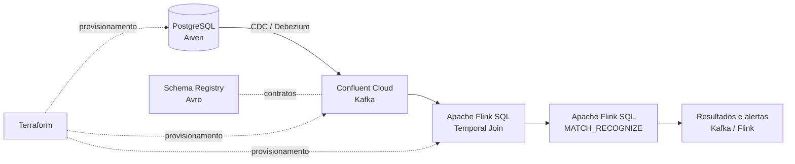

# Real-Time Payment Fraud Pipeline

Pipeline de processamento de pagamentos em tempo real, com captura de alterações no PostgreSQL, streaming no Apache Kafka e detecção de padrões suspeitos por meio de Apache Flink SQL.

O projeto demonstra como integrar serviços gerenciados de banco de dados, mensageria e processamento de eventos utilizando **infraestrutura como código**, contratos de dados e consultas SQL contínuas.

Os [requisitos e critérios de aceite](docs/requirements.md) resumem o escopo exigido para a entrega e distinguem implementações de evidências de execução.

## Visão geral

Uma transação registrada no PostgreSQL precisa se tornar um evento disponível para análise com o menor atraso possível. Neste projeto, essa propagação ocorre por **Change Data Capture (CDC)**: alterações no banco são capturadas pelo Debezium e publicadas em tópicos Kafka. O Flink consome os eventos, realiza enriquecimento temporal e identifica sequências de pagamentos potencialmente suspeitas.

A regra analítica central identifica **três transações de um mesmo cartão em uma janela de 60 segundos**, usando `MATCH_RECOGNIZE` do Flink SQL. A detecção é um exemplo didático de processamento de eventos complexos (*Complex Event Processing — CEP*), e não um motor de prevenção de fraude pronto para produção.

### Arquitetura



| Componente | Responsabilidade |
| --- | --- |
| **Aiven PostgreSQL** | Armazenamento transacional e origem dos registros de pagamentos. |
| **Debezium CDC (Confluent Cloud)** | Captura de alterações do PostgreSQL e publicação dos eventos no Kafka. |
| **Apache Kafka** | Transporte de eventos entre a origem e o processamento. |
| **Schema Registry / Avro** | Gerenciamento dos contratos e da compatibilidade de schemas. |
| **Apache Flink SQL** | Enriquecimento temporal, análise de eventos e detecção do padrão de fraude. |
| **Terraform** | Declaração e gerenciamento da infraestrutura e das permissões. |
| **GitHub Codespaces** | Ambiente de execução padronizado, com as ferramentas necessárias. |

## Pré-requisitos

É necessário possuir:

- Uma conta GitHub com acesso ao **GitHub Codespaces**.
- Uma conta **Aiven** com permissão para administrar um serviço PostgreSQL compatível com replicação lógica.
- Uma conta **Confluent Cloud** com permissões para Kafka, Schema Registry, Connect e Flink, conforme os recursos provisionados.
- Credenciais de API válidas para os provedores, configuradas como segredos do ambiente.
- Créditos ou orçamento para executar serviços gerenciados. **A infraestrutura não é necessariamente gratuita.**

O Codespace utiliza Python 3.12 e instala Terraform 1.16.2 e Confluent CLI 4.81.0 por meio dos arquivos em `.devcontainer/`. As versões são referências da configuração do projeto; consulte também `infra/terraform/versions.tf` para as restrições dos providers.

> **Custos:** o conector CDC gerenciado pode gerar cobrança enquanto estiver provisionado, mesmo sem processar novos registros. Planeje uma janela curta de execução e o desligamento dos recursos que não precisam permanecer ativos.

## 1. Preparar o ambiente de desenvolvimento

Abra o repositório no GitHub e selecione **Code → Codespaces → Create codespace on main** (ou na branch publicada que contenha a versão a reproduzir).

No terminal do Codespace, execute, a partir da raiz do repositório:

```bash
python3 lab.py setup
python3 lab.py check-cli
python3 lab.py test
```

Esses comandos preparam e verificam as ferramentas locais e executam a suíte de testes. **Não provisionam o pipeline nem demonstram, isoladamente, a comunicação entre os serviços.**

Caso o Codespace seja reconstruído, confira se as configurações e os segredos continuam disponíveis antes de prosseguir.

## 2. Configurar as credenciais

Cadastre as credenciais externas em **GitHub → Settings → Codespaces → Codespaces secrets**, habilitando seu uso no repositório. Consulte a [documentação de segredos do GitHub Codespaces](https://docs.github.com/en/codespaces/managing-your-codespaces/managing-your-account-specific-secrets-for-github-codespaces).

| Variável | Finalidade |
| --- | --- |
| `AIVEN_TOKEN` | Autenticação da API da Aiven. |
| `CONFLUENT_CLOUD_API_KEY` | Autenticação da API da Confluent Cloud. |
| `CONFLUENT_CLOUD_API_SECRET` | Segredo correspondente à API da Confluent Cloud. |
| `KAFKA_API_KEY` / `KAFKA_API_SECRET` | Acesso ao cluster Kafka por aplicações ou scripts. |
| `SCHEMA_REGISTRY_API_KEY` / `SCHEMA_REGISTRY_API_SECRET` | Acesso ao Schema Registry. |

O arquivo `.env.example` apresenta os nomes esperados. A configuração também pode ser fornecida em um arquivo `.env` local e não versionado. Quando aplicável, credenciais Kafka e Schema Registry são geradas pelo Terraform e podem ser exportadas com:

```bash
python3 scripts/export_foundation_env.py
```

**Execute a exportação somente depois do provisionamento dos recursos correspondentes.** Os valores existentes no ambiente têm precedência sobre valores do arquivo `.env`.

Nunca publique arquivos `.env`, State do Terraform, segredos, certificados privados ou respostas de comandos que exponham credenciais. Após alterar Codespaces Secrets, reinicie o Codespace para disponibilizá-los à sessão.

## 3. Provisionar a infraestrutura

Os arquivos de infraestrutura estão em `infra/terraform/`. Eles descrevem os serviços de origem, recursos da Confluent Cloud, identidades, permissões, contratos de dados e componentes necessários ao processamento.

Antes de realizar qualquer alteração remota:

```bash
python3 lab.py plan
```

Revise as ações propostas, os recursos afetados e o custo estimado. **Um plano não provisiona recursos.** A aplicação deve utilizar o procedimento controlado de Terraform disponibilizado no repositório, respeitando as aprovações e as verificações previstas nesse procedimento.

A implantação depende de credenciais válidas e de configurações específicas da conta. Identificadores de ambiente, cluster e Compute Pool devem ser obtidos dos recursos provisionados, e não copiados de execuções anteriores.

Após a aplicação, confirme o inventário:

```bash
confluent environment list
confluent kafka cluster list
confluent flink compute-pool list
confluent iam service-account list
confluent kafka acl list
```

Esses comandos consultam a conta ativa na CLI. Verifique se o contexto selecionado corresponde ao ambiente implantado.

## 4. Preparar os dados e iniciar a captura CDC

O fluxo de ingestão começa no PostgreSQL. A origem deve conter as tabelas transacionais exigidas pelo projeto e estar configurada para permitir replicação lógica.

O conector gerenciado Debezium lê as alterações dessas tabelas e as envia aos tópicos Kafka. **Sua criação é uma operação remota potencialmente faturável.** Utilize o procedimento de ativação e desativação definido no Terraform e nos scripts do repositório; não crie um conector manual paralelo.

Para verificar os conectores disponíveis:

```bash
confluent connect cluster list
```

Para consultar os tópicos do cluster selecionado:

```bash
confluent kafka topic list
```

**Validação esperada:** eventos originados por alterações no PostgreSQL chegam ao Kafka com os schemas previstos. A existência do conector ou dos tópicos, por si só, não comprova que o CDC esteja entregando eventos.

## 5. Executar o processamento no Flink

Os arquivos SQL do projeto ficam organizados no diretório `sql/`. Os componentes principais são:

1. **Enriquecimento temporal:** combinação de transações com o estado correspondente das contas no instante do evento (*temporal join*).
2. **Detecção do padrão:** aplicação de `MATCH_RECOGNIZE`, particionando os eventos por cartão e identificando três transações em até 60 segundos.
3. **Consulta contínua:** materialização dos resultados da detecção para inspeção e consumo posterior.

Consulte os arquivos:

```text
sql/fraud_detection/pattern/01_match_recognize.sql
sql/fraud_detection/continuous/01_continuous_matches.sql
sql/fraud_detection/continuous/02_inspect_matches.sql
```

O processamento contínuo deve ser iniciado com o executor Flink do repositório, após a disponibilização da origem Kafka e a validação das permissões da identidade de execução. Utilize a ajuda dos scripts para conferir os argumentos aceitos pela versão instalada, em vez de inserir IDs ou nomes fixos nos comandos.

O resultado esperado é a identificação de uma sequência de três transações de um mesmo cartão dentro do intervalo definido, mantendo identificadores que permitam rastrear os registros participantes.

## 6. Simular transações e verificar a detecção

O projeto contém um gerador de cenários em:

```text
scripts/etapa12_scenarios.py
```

Primeiro, confira o plano local:

```bash
python3 scripts/etapa12_scenarios.py plan
```

Durante a janela de integração, com o conector CDC e o processamento contínuo ativos, execute o cenário autorizado usando a interface `execute` do mesmo script. Ele foi desenvolvido para produzir um caso de controle e uma sequência de transações sintéticas que satisfaça o padrão de detecção.

Para inspecionar as correspondências, consulte o executor e o SQL de leitura em:

```text
scripts/etapa11_execution.py
sql/fraud_detection/continuous/02_inspect_matches.sql
```

**O que comprova o funcionamento de ponta a ponta:**

- As transações sintéticas foram persistidas no PostgreSQL.
- Os eventos correspondentes chegaram aos tópicos Kafka via CDC.
- O Flink consumiu e processou os eventos, preservando o tempo de evento esperado.
- O padrão de três transações foi detectado e seus identificadores puderam ser rastreados.
- Os resultados ou alertas ficaram disponíveis no destino configurado.

Uma consulta SQL compilada ou um statement ativo não substitui essas evidências funcionais.

## 7. Testes, monitoramento e evidências

Para executar os testes automatizados locais:

```bash
python3 lab.py test
```

Para inspecionar recursos e consumo na Confluent Cloud:

```bash
confluent kafka cluster list
confluent flink compute-pool list
confluent iam service-account list
confluent kafka acl list
confluent billing cost list --start-date AAAA-MM-DD --end-date AAAA-MM-DD
```

Substitua as datas pelo período de interesse. A data final é exclusiva na consulta de billing; registros recentes podem aparecer com atraso.

O projeto inclui um coletor de evidências em `scripts/etapa13_collect.py`. A coleta separa o contexto de ambiente e produz um resumo local sanitizado de inventário, ACLs e billing. Consulte sua interface para os parâmetros aceitos e mantenha a exportação fora do controle de versão. O resultado deve ser conferido contra a conta e o período selecionados antes de ser utilizado como evidência formal.

Os documentos em `docs/` registram contratos analíticos, critérios de validação e evidências das etapas de processamento.

## 8. Encerrar a execução e controlar custos

Após a validação funcional:

1. Interrompa os statements contínuos que não precisem permanecer ativos.
2. Desative ou destrua o conector CDC pelo procedimento controlado do Terraform.
3. Confira o estado remoto dos conectores e demais recursos sujeitos a cobrança.
4. Consulte o billing para verificar o consumo associado à janela de execução.
5. Preserve as evidências sanitizadas e os registros necessários à auditoria da execução.

**Não exclua o Codespace ou o State local do Terraform antes de confirmar o encerramento dos recursos remotos administrados por esse State.** A remoção do ambiente local sem essa verificação pode dificultar a administração ou a destruição dos recursos restantes.

A exclusão de infraestrutura deve ser deliberada e compatível com o plano Terraform revisado; não execute `terraform destroy` indiscriminadamente.

## Estrutura do repositório

```text
.devcontainer/        Ambiente e instalação de ferramentas no Codespaces
infra/terraform/      Infraestrutura como código
scripts/             Automação operacional, cenários e coleta de evidências
sql/                 Consultas SQL de enriquecimento e detecção
tests/               Testes automatizados
docs/               Contratos, procedimentos e evidências técnicas
.env.example         Modelo de variáveis de ambiente
lab.py               Interface para preparação, validação e testes locais
README.md            Guia de arquitetura e utilização
```

## Segurança e boas práticas

- Utilize credenciais com o menor privilégio necessário e não as adicione ao repositório.
- Trate Terraform State e arquivos de plano como material sensível.
- Consulte o ambiente selecionado antes de executar comandos remotos.
- Prefira os scripts e configurações versionados a alterações manuais na interface dos provedores.
- Use dados sintéticos para demonstrações e testes.
- Registre evidências sem senhas, API Keys, tokens ou dados de pagamento reais.
- Verifique limites gratuitos, créditos, preços vigentes e consumo antes de provisionar componentes faturáveis.

## Referências

- [Aiven — PostgreSQL](https://aiven.io/docs/products/postgresql)
- [Confluent Cloud — documentação](https://docs.confluent.io/cloud/current/overview.html)
- [Apache Flink — documentação](https://flink.apache.org/)
- [Terraform — documentação](https://developer.hashicorp.com/terraform/docs)
- [GitHub Codespaces — documentação](https://docs.github.com/en/codespaces)

---

**Nota de execução:** este README descreve os recursos, o fluxo operacional e os critérios de validação. A execução integrada deve ser comprovada por evidências coletadas no ambiente efetivamente provisionado; resultados de testes locais não equivalem à homologação do pipeline em nuvem.
