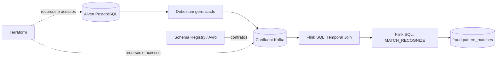

# Arquitetura do pipeline

## Objetivo e limites

O laboratório demonstra captura de mudanças transacionais, transporte Kafka, contratos Avro e detecção de um padrão de velocidade de pagamentos. A regra é sintética e **não constitui um motor antifraude de produção**.

## Contratos e granularidade

- Origem PostgreSQL: estrutura em `database/migrations/01_schema.sql`, dados sintéticos em `database/seeds/02_seed.sql` e privilégios em `database/security/03_cdc_grants.sql`.
- Kafka/CDC: configuração declarada em `infra/terraform/cdc-connector.tf`; os subjects de CDC são geridos pelo Debezium. O bloco `removed` em `cdc-schemas.tf` evita a remoção remota de subjects previamente geridos pelo Terraform; **exige revisão do plano de migração de State**.
- Contratos Avro: `schemas/registry/`. A presença de arquivos versionados não equivale à confirmação de registro ativo no Schema Registry.
- Temporal Join: consulta em `sql/enrichment/04_temporal_join.sql`, com preparação de metadados em `scripts/flink_setup.py`.
- Detecção: `sql/fraud_detection/pattern/01_match_recognize.sql`, por cartão, três transações positivas em até 60 segundos. A materialização contínua é descrita em `sql/fraud_detection/continuous/01_continuous_matches.sql`.
- Destino: `fraud.pattern_matches`, documentado em [contrato de alertas](alert-contract.md). Não presumir que o tópico exista sem evidência da execução do CTAS.

## Decisões e trade-offs

1. **Serviços gerenciados** reduzem manutenção de infraestrutura local, mas criam dependência de credenciais, permissões, disponibilidade e custos de terceiros.
2. **Terraform** declara infraestrutura e acessos; não substitui a validação de estado dos serviços, de dados processados e de statements SQL.
3. **CDC com Schema Registry** separa captura dos eventos de sua interpretação, exigindo compatibilidade de schemas e acompanhamento de evolução.
4. **Temporal Join** associa transações ao estado temporal das contas; depende da configuração correta de Primary Key, changelog e tempo de evento.
5. **MATCH_RECOGNIZE** demonstra detecção de sequência; não mede desempenho, falsos positivos nem aptidão de uso bancário real.
6. **Estado Terraform é sensível** e necessário à administração de recursos; sua perda pode deixar recursos em cobrança sem gerenciamento.

## Segurança e privacidade

Utilizar apenas dados de teste autorizados. Nunca versionar tokens, segredos, planos binários, State, IDs financeiros reais ou logs com valores sensíveis. Os arquivos de evidência devem ser revisados antes da publicação. Detalhes em [operação](operations.md).
